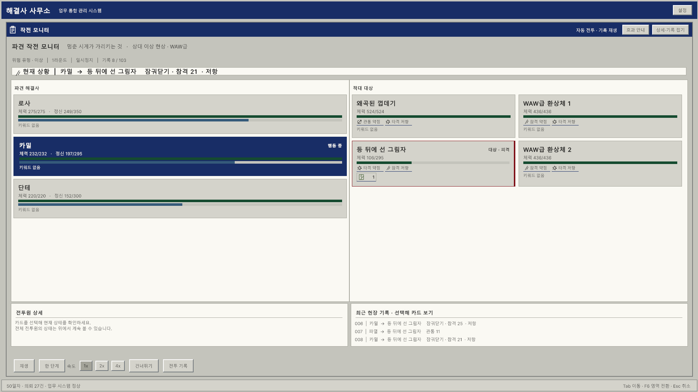
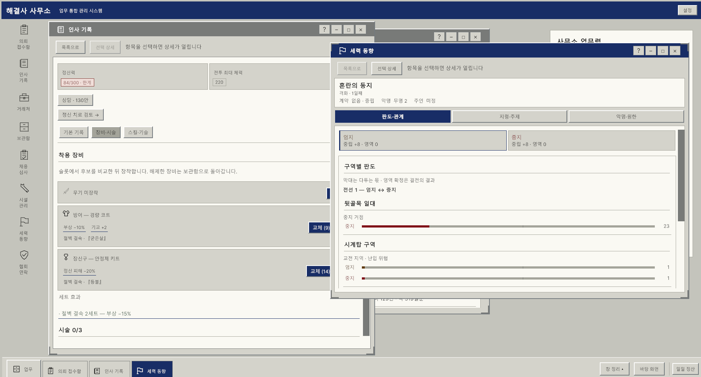
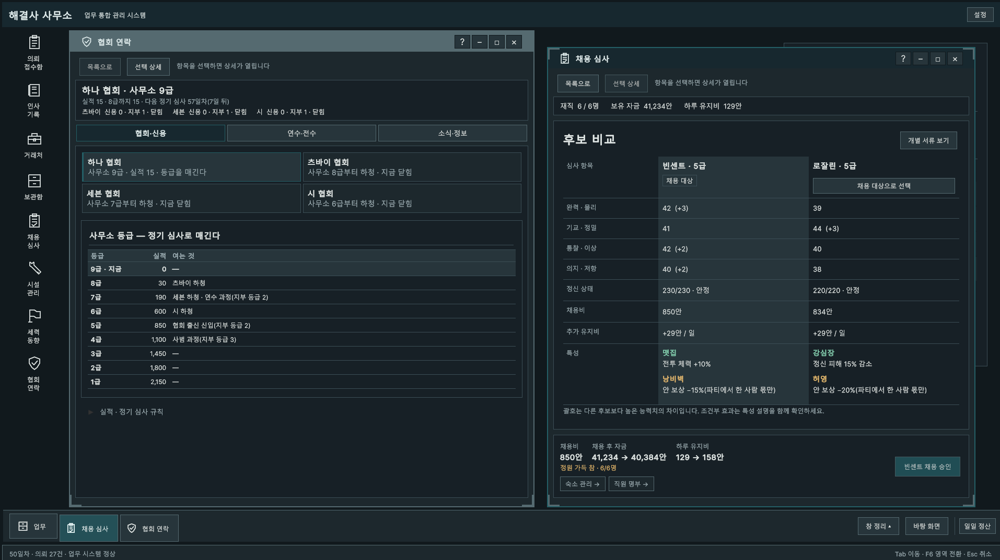

# Fix_Office — 해결사 사무소

> Project Moon 세계관 2차 창작 팬게임 · 비상업 무료 배포 · Windows 64비트

## 다운로드

**[최신 버전 받기](https://github.com/GreenTeaSlime/Fix_Office/releases/latest)** — `Fix_Office_v…_win64.zip`

지난 버전은 [Releases](https://github.com/GreenTeaSlime/Fix_Office/releases)에 있습니다.

## 어떤 게임인가요

도시 뒷골목의 작은 해결사 사무소를 맡아 해결사를 뽑고 키우고, 의뢰를 골라 파견하는 운영 시뮬레이션 · 로그라이트입니다.

- **파견과 오토배틀** — 의뢰마다 편성을 짜고, 전투 미리보기로 승산을 따진 뒤 내보냅니다. 전투는 배속 · 일시정지 · 한 단계씩 다시 볼 수 있습니다.
- **해결사 운영** — 채용 · 육성 · 승급, 특성과 기술, 장비 · 시술 · 인장으로 사람을 만들어 갑니다.
- **정신과 붕괴** — 상처와 정신이 한계에 닿으면 결의 시험으로 무너지거나 각성합니다.
- **도시의 세력** — 구역 장악, 손가락과 협회 사이에서 신임과 적의를 쌓습니다.
- **네 막의 이야기** — 막마다 보스가 있고, 마지막에는 폐쇄 구획 너머의 것과 맞서게 됩니다.

| 업무 창 — 인사 기록 · 세력 동향 | 통제실 테마 — 협회 연락 · 채용 심사 |
|---|---|
|  |  |

## 실행 방법

1. zip을 원하는 폴더에 전부 풉니다.
2. `Fix_Office.exe`를 실행합니다.
3. "Windows의 PC 보호" 창이 뜨면 **추가 정보 → 실행**을 누릅니다(코드 서명이 없는 개인 제작 게임이라 뜨는 경고입니다).

권장 환경: Windows 10 / 11 64비트, 1920×1080

저장 위치: `%USERPROFILE%\AppData\LocalLow\Margin Office\Fix_Office` (게임 안 설정 ▸ 정보 ▸ 저장 폴더 열기)

## 버그 제보

[Issues](https://github.com/GreenTeaSlime/Fix_Office/issues)에 남겨 주세요. 저장 위치에 있는 `Player.log`와, 오류 안내가 떴다면 `fixoffice_errors.txt` · `fixoffice_emergency.json`을 첨부해 주시면 원인을 찾기 쉽습니다.

## 만든 방식

- Unity 6 · UI Toolkit(UXML/USS) — 다중 창 데스크톱 UI
- 게임 규칙은 엔진에 의존하지 않는 순수 C# 코어로 분리하고, NUnit 테스트 800여 개로 검증
- 밸런스는 실제 코어를 돌리는 시뮬레이션 봇(정책별 수백 판)으로 측정하고 조정

<!-- 포트폴리오 링크나 개발 기록이 있으면 여기에 -->

## 고지

이 게임은 Project Moon의 세계관을 바탕으로 만든 비공식 팬 창작물이며, Project Moon과는 관련이 없습니다. 원작에 대한 모든 권리는 Project Moon에 있습니다. 비상업 목적으로 무료 배포하며, 판매하거나 유료로 다시 배포하는 것을 금합니다.
